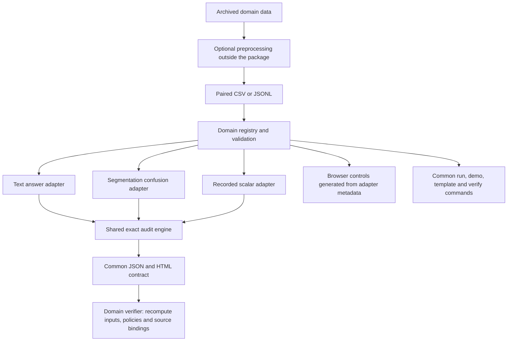

# Modular audits across domains

Version 0.6.0 separates measurement semantics from the common audit machinery.
A domain adapter defines input validation, scoring policies and replay. The
shared layer computes exact signed bands and exports the same report contract.
The command line and local browser discover adapters through one registry.



## Choose the input that preserves the measurement

| Domain | Paired input | Explicit choices | Example uses |
| --- | --- | --- | --- |
| `text` | Prompt, reference, raw A/B outputs | Extraction, correctness, aggregation | Archived question answering |
| `segmentation` | A/B integer confusion matrices with matching true-class totals | One class target, count pooling or equal image/group weights, empty unions | Cached semantic segmentation predictions |
| `scores` | Recorded A/B decimal scores | One metric, unit and preferred direction; mean, median, group mean | Latency, error, accuracy, experiment logs |

Use `scores` if your upstream tool already calculates a reliable scalar metric.
Use a dedicated adapter when the audit must recalculate a domain's metric from
sufficient statistics or raw outputs. Converting predictions to a scalar can
discard information needed to examine other scoring choices.

Every audit compares one declared target. Audit overall mIoU and a rare class
separately; audit latency and accuracy separately. The current tool does not
infer utility weights or combine multiple objectives into one ranking.

## Try all three adapters

```bash
python -m robustband domains
python -m robustband demo --domain text --output audit-demo/text
python -m robustband demo --domain segmentation --output audit-demo/segmentation
python -m robustband demo --domain scores --output audit-demo/scores
python -m robustband verify audit-demo/scores/report.json
```

The browser's **Data kind** selector provides the same adapters, templates and
defaults. Supported formats, policy controls, group requirements and preview
columns are supplied by adapter metadata. Adding a compatible adapter does not
require adding another HTTP branch or editing the browser's domain selector.

## Recorded numeric metrics

```csv
sample_id,score_a,score_b,metric,unit,direction,group
run-1,9.1,10.2,latency,ms,lower,device-1
run-2,11.4,10.5,latency,ms,lower,device-2
```

The required fields are `sample_id,score_a,score_b,metric,unit,direction`.
`group` is optional unless `group_mean` is selected. IDs must be unique, and the
metric/unit/direction triple must match throughout the file. Missing values,
NaN, infinity and mixed targets are rejected. CSV scores and JSON decimal numbers
are read exactly; the Python API accepts decimal strings, integers or `Decimal`,
and rejects binary floats. At most 256 significant digits and decimal exponents
up to 128 in magnitude are accepted.

- `direction=higher`: oriented margin is **A − B**.
- `direction=lower`: oriented margin is **B − A**.
- A positive margin always supports the declared preference for A.
- `mean`: equal sample weights.
- `median`: median of A's values minus median of B's values, with the direction
  applied. This is not the median of paired differences.
- `group_mean`: mean within each group, then equal weights across groups.
- `unit=percent` means scores are already on the 0–100 percent scale; differences
  display as percentage points (`pp`). `fraction` remains on its supplied scale.
  Units are labels, not an automatic unit conversion system.

```bash
python -m robustband template metrics.csv --domain scores
python -m robustband scores metrics.csv --aggregations mean median --output audit-results
python -m robustband verify audit-results/report.json
```

The exact JSON is authoritative; decimal displays and the plot are rounded.
An exact difference smaller than the displayed precision still determines the
verdict. The report includes its measurement target and preferred direction.
Auditing logged scores does not independently reproduce their original grading,
timing process or checkpoint fairness. Upstream rounding remains a limitation.

## Segmentation counts

```json
{"sample_id":"image-1","group":"sequence-1","class_names":["background","object"],"confusion_a":[[9,0],[0,1]],"confusion_b":[[9,0],[1,0]]}
```

Rows are true labels, columns are predicted labels. Matrices have 2–64 classes,
nonnegative integer entries and identical true-class row totals for A and B.
Counts fit signed 64-bit integers. Every image must use the same class order.
Matching totals are a necessary consistency check; the producer must also verify
that the original image/label arrays and sample IDs match.

```bash
python -m robustband segment counts.jsonl --classes 1 --aggregations pooled image_mean group_mean --empty-classes zero omit --output audit-results
```

`--classes 1` selects one class; omitting it selects all classes. Each policy
computes class IoU from TP/(true count + predicted count − TP), then averages the
selected classes. `pooled` sums counts across images first; `image_mean` gives
each image equal weight; `group_mean` pools within each explicit group, then gives
groups equal weight. This group policy differs from the scalar adapter's mean
within group. Undefined class unions are explicitly zeroed or omitted. Omission
can change model-specific denominators; diagnostics report undefined counts and
defined averaging units. Duplicate numerical outcomes are not independent votes.

For cached `.npz` files containing integer `pred` and `gt` arrays, an optional
preprocessing helper checks full ID sets, array shapes, label ranges and identical
ground truth before calculating paired counts:

```bash
python examples/prepare_segmentation_npz.py predictions_a predictions_b --n-classes 8 --group-separator _ --output counts.jsonl
```

This helper requires NumPy only for preprocessing. It records source file hashes,
array hashes and the grouping rule in a companion `.sources.json`. The core,
browser, audit and replay still use only the Python standard library. Keep raw
data and source manifests local unless their redistribution is authorized.
If cached basenames append a suffix such as `_probs`, declare `--id-suffix _probs`
to remove it consistently. Every filename must match the declared rule; sample
identity is not guessed from dataset names.

## Add a trusted Python adapter

The public interface is `robustband.domains.AuditDomain`:

| Operation | Contract |
| --- | --- |
| `load(text, format)` | Validate paired identity/context and return normalized records |
| `preview(rows)` | `n_items`, first records, and availability flags for controls |
| `analyze(rows, family, model_a, model_b)` | The common audit report with exact oriented margins |
| `verify(report)` | Recompute and compare the entire bound report; reject changed semantics |
| `metadata` | Titles, required fields, formats, defaults, example, preview columns and controls |

Implement these operations in one module, then explicitly register it:

```python
from robustband.domains import AuditDomain, register_domain, audit_domain
from my_domain import load, preview, analyze, verify, metadata

register_domain(AuditDomain(
    id="my_domain", schema="my_project.audit/v1", formats=("csv", "jsonl"),
    load=load, preview=preview, analyze=analyze, verify=verify, metadata=metadata,
))
report = audit_domain("my_domain", paired_text, format="csv", family=my_policies)
```

Use `audit_engine.assemble` for the common envelope. Supply exact scores, oriented
margin strings, the adapter's scoring source files, warnings and measurement
limits. Its source hash is added automatically. Generic report `sections` contain
a title, columns and rows; both HTML and the browser render them without a domain
branch. Include the adapter's policy settings in `family` and recompute all fields
in its verifier. See `scores.py` for a complete scalar implementation and
`tests/test_scores_domains.py` for contract and tampering checks.

Metadata controls support checkbox choices (`kind="checks"`), explicit class-index
selection (`kind="classes"`), single choices (`kind="select"`), decimal parameter
strings (`kind="number"`) and free text (`kind="text"`). Each has a `key`, bilingual
`title`, and a corresponding `defaults` value. Checkbox options have `value`,
`title`, and an optional dotted `requires` path into preview availability flags.
Single-choice options have `value` and `title`. Decimal and text defaults are
strings; decimal controls preserve input precision and their adapters validate
ranges. More specialized controls require extending that vocabulary. The
[editable measurement lab](editions.md) demonstrates algorithm and parameter use.

Registration is process-local and accepts trusted Python code. To use a custom
adapter with the CLI or UI, register it in your own Python launcher before calling
`robustband.cli.main()` or `robustband.local_ui.run_ui()`. An uploaded data file
does not install or execute plugins. Optional model/image/database dependencies
belong in external preparation tools; dependencies under `robustband/` stay empty.

## Scope of the extension

This modular design adds domain reuse and explicit measurement handling. It does
not establish a new statistical method, independent users, population inference
or automatic support for arbitrary raw data formats. The original text library's
default 5 × 4 × 4 = 80 protocols and historical scoring semantics remain unchanged.
The adapters use different declared families; their protocol counts do not alter
that default. Module tests, exact hand-checkable examples and browser checks are
automated consistency evidence.
